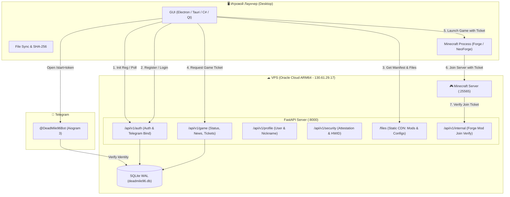

# 🎙 VovaweLauncher Backend & Security API
### High-Performance Backend, Telegram Auth Gateway & Client Distribution for Dead Mile '96

<p align="center">
  
  
  
  
  
  
  
</p>

---

## 📌 Оглавление
1. [Обзор проекта](#-обзор-проекта)
2. [Архитектура системы](#-архитектура-системы)
3. [Ключевые возможности](#-ключевые-возможности)
4. [Дерево директорий](#-дерево-директорий)
5. [Развертывание на VPS](#-развертывание-на-vps)
6. [API Endpoints & Документация](#-api-endpoints--документация)
7. [Руководство по разработке Лаунчера](#-руководство-по-разработке-лаунчера)
8. [Безопасность и HWID](#-безопасность-и-hwid)

---

## 📖 Обзор проекта

**VovaweLauncher Backend** — серверная инфраструктура для кастомного игрового лаунчера постапокалиптического Minecraft-проекта **Dead Mile '96**. 

Сервер обеспечивает:
- 🛡 **Двухфакторную регистрацию и сброс паролей через Telegram Bot** (защита от ботов и мультиаккаунтов).
- 🎫 **Систему одноразовых игровых тикетов (Game Tickets)** с верификацией при входе на игровой Forge-сервер.
- 📡 **Синхронизацию файлов сборки (Manifest & CDN)**: дифференциальное обновление модов, конфигов и шейдеров с проверкой SHA-256.
- 🎮 **Живой мониторинг Minecraft-сервера** по SLP протоколу (онлайн, пинг, MOTD).
- 📰 **Атмосферную ленту новостей и патчноутов** с бейджами выживших.
- 🕵️ **Анти-тампер аттестацию** и сбор телеметрии аппаратных конфигураций (HWID).

---

## 🏛 Архитектура системы



---

## ⚡ Ключевые возможности

| Модуль | Описание |
|---|---|
| **FastAPI Core** | Асинхронная обработка запросов, ORJSON-сериализация, Pydantic v2 валидация. |
| **Telegram Gateway** | Deep-link авторизация без паролей в Telegram; моментальный поллинг статуса подтверждения. |
| **Dynamic Manifest** | Утилита `build_manifest.py` сканирует моды и assets, вычисляет SHA-256 и отдает ETag для моментального 304 Not Modified. |
| **Static CDN** | Встроенная раздача файлов сборки через `/files/` без обязательного Nginx. |
| **HWID Device Tracking** | Учет материнских плат, процессоров, GPU, ОС и backend'ов (Vulkan/OpenGL) с системой штрафных очков. |
| **Audit & Telemetry** | Ротация логов, сбор сетевой задержки, обнаружение модификаций клиента. |

---

## 📂 Дерево директорий

```text
VovaweLauncher/
├── app/
│   ├── api/
│   │   ├── auth.py          # Регистрация, логин, Telegram-связка
│   │   ├── deps.py          # FastAPI dependencies, rate-limiter, auth context
│   │   ├── game.py          # Статус MC, новости, манифест сборки, тикеты
│   │   ├── internal.py      # Защищенный API для Forge-мода (проверка тикета)
│   │   ├── profile.py       # Профиль игрока, история и кулдаун смены никнейма
│   │   └── security.py      # Анти-тампер челленджи и телеметрия
│   ├── bot/
│   │   └── handlers.py      # Aiogram роутер Telegram-бота (@DeadMile96Bot)
│   ├── core/
│   │   ├── responses.py     # Стандартизированный JSON-формат ответов и ошибок
│   │   └── security.py      # Argon2 хэширование, генераторы токенов, UUID
│   ├── services/
│   │   ├── bans.py          # Проверка банов (User, HWID, IP, TG)
│   │   ├── cache.py         # Кеш манифеста, новостей и статуса сервера
│   │   ├── logger.py        # Асинхронный сброс request & audit логов в БД
│   │   └── mc_ping.py       # VarInt Minecraft SLP пинг в фоне
│   ├── config.py            # Pydantic Settings (.env парсинг)
│   ├── db.py                # aiosqlite менеджер + автомиграции DDL
│   └── main.py              # Точка входа FastAPI + Lifespan менеджер
├── deploy/
│   ├── deadmile.service              # Пример шаблона
│   └── vovawelauncher_api.service    # Боевой systemd-юнит для VPS
├── tools/
│   └── build_manifest.py    # Сборщик data/manifest.json по client_files/
├── data/                    # БД SQLite, манифест и файлы клиентов (в .gitignore)
├── .ai/                     # Долгосрочная память и спецификации для AI
│   ├── api_reference.txt    # Полный каталог эндпоинтов и JSON-схем
│   ├── launcher_guide.txt   # Пошаговый алгоритм создания GUI лаунчера
│   ├── overview.txt         # Архитектурный снимок
│   └── vps_deployment.txt   # Конфигурация VPS и боевые команды
├── .env.example             # Шаблон переменных окружения
├── pyproject.toml           # Зависимости проекта
└── README.md
```

---

## 🚀 Развертывание на VPS

Сервер развернут в изолированной рабочей области:
- **Хост:** `130.61.29.17:8000`
- **Каталог:** `/home/opc/ai_workspace/vovawelauncher`
- **Служба:** `vovawelauncher_api.service`

### Управление сервисом на сервере:
```bash
# Просмотр статуса
sudo systemctl status vovawelauncher_api.service

# Перезапуск
sudo systemctl restart vovawelauncher_api.service

# Чтение логов в реальном времени
sudo journalctl -u vovawelauncher_api.service -f
```

---

## 📡 API Endpoints & Документация

Интерактивная Swagger UI документация доступна по адресу:  
👉 **`http://130.61.29.17:8000/docs`**

OpenAPI JSON схема:  
👉 **`http://130.61.29.17:8000/openapi.json`**

### Быстрый чеклист для лаунчера:
| Метод | Путь | Назначение |
|---|---|---|
| `GET` | `/health` | Проверка доступности API |
| `GET` | `/api/v1/game/status` | Пинг онлайна, MOTD, версия сервера |
| `GET` | `/api/v1/game/news` | Список новостей и патчноутов |
| `GET` | `/api/v1/game/manifest` | Хэши файлов сборки для синхронизации |
| `POST` | `/api/v1/auth/tg/init` | Старт Telegram-авторизации |
| `GET` | `/api/v1/auth/tg/poll` | Опрос подтверждения из бота |
| `POST` | `/api/v1/auth/register` | Регистрация аккаунта |
| `POST` | `/api/v1/auth/login` | Вход по логину и паролю |
| `POST` | `/api/v1/game/ticket` | Получение тикета запуска игры |
| `GET` | `/files/{file_path}` | Скачивание мода / ресурса |

---

## 💻 Руководство по разработке Лаунчера

Подробное руководство со всеми структурами данных, формулами HWID и аргументами JVM находится в [.ai/launcher_guide.txt](file:///run/media/vovawe/17dab7fa-67e3-4206-bb42-8a77caa7ef4c/VovaweLauncher/.ai/launcher_guide.txt).
